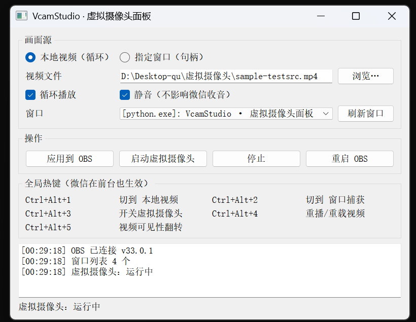

<div align="center">

# VcamStudio

**Windows 虚拟摄像头控制面板 —— 把摄像头画面换成本地视频或任意窗口**

指定 mp4（循环播放）· 指定窗口句柄 · 全局热键切换 · 微信/QQ/会议软件通用



</div>

---

## 它做什么

在「摄像头设备」这一层做替换：系统里多出一个叫 `OBS Virtual Camera` 的摄像头，任何调用摄像头的程序（微信视频通话、QQ、Teams、浏览器 `getUserMedia`）选中它，看到的就是你指定的画面。

微信不用改一行代码——它以为自己在读真摄像头，编码、加密、协商全照常。

```
摄像头设备  ──►  目标程序 采集/编码 H.264  ──►  加密传输  ──►  对方
     ▲
     └── VcamStudio（经 OBS 虚拟摄像头）在这里冒充真实设备
        ├─ 本地 mp4（循环 / 重播）
        └─ 指定窗口（播放器、网页、游戏、任意 HWND 的窗口）
```

## 特性

| 功能 | 说明 |
|---|---|
| 本地视频源 | 选 mp4/mkv/mov/avi/webm，循环播放，按视频比例自动定画布（竖屏不会被塞进 16:9） |
| 窗口源 | 从 OBS 的窗口列表里挑一个窗口当摄像头画面，支持窗口标题/进程名筛选 |
| 全局热键 | `Ctrl+Alt+1..5` 切源、开关虚拟摄像头，微信在前台时不抢焦点 |
| 一键启停 | 自动拉起/收起 OBS 后台，自动开 obs-websocket，自动开虚拟摄像头 |
| 自检 | `--selftest` 无界面跑完整链路并从虚拟摄像头抓一帧验证真有画面 |
| 零第三方 WebSocket 库 | 手写 RFC6455 客户端，只依赖 PyQt5 / Pillow / numpy |

## 环境要求

- Windows 10/11 x64
- Python 3.10+（本项目在 3.13 上跑通）
- **OBS Studio 便携版**（默认 `D:\dev\OBS`，可用 `VCAM_OBS_ROOT` 覆盖）
- **ffmpeg / ffprobe**（默认 `D:\dev\tools\ffmpeg\bin`，可用 `VCAM_FFMPEG_DIR` 覆盖）
- 虚拟摄像头**必须机器级注册**（HKLM，需要一次管理员），原因见下

```bash
pip install -r requirements.txt
```

## 快速开始

```text
1) 装 OBS 便携版到 D:\dev\OBS（或用 1-安装OBS.bat，走清华镜像）
2) 右键「2-注册虚拟摄像头(管理员).bat」→ 以管理员身份运行（只需一次）
3) 双击「3-启动虚拟摄像头.bat」或直接 python VcamStudio.py
4) 目标程序里把摄像头选成 OBS Virtual Camera
```

面板里：选片子 → 点「应用到 OBS」→ 状态栏出现 `虚拟摄像头：运行中` 即可。

### 命令行

```bash
python VcamStudio.py            # 打开面板
python VcamStudio.py --selftest # 无界面自检：连 OBS → 设源 → 抓帧 → 校验非全黑
```

## 全局热键

| 热键 | 动作 |
|---|---|
| `Ctrl+Alt+1` | 切到本地视频 |
| `Ctrl+Alt+2` | 切到窗口捕获 |
| `Ctrl+Alt+3` | 开关虚拟摄像头 |
| `Ctrl+Alt+4` | 重播/重载视频 |
| `Ctrl+Alt+5` | 查询视频源 scene item id（排错用） |

## 工作原理

```
VcamStudio.py  ──obs-websocket(4455, JSON)──►  OBS（后台，托盘）
      │                                            │
      │  SetVideoSettings   改画布/帧率              │  合成场景
      │  SetInputSettings   改片源/窗口              │      │
      │  SetSceneItemEnabled 切源可见性              │      ▼
      │  StartVirtualCam/StopVirtualCam             │  DirectShow 虚拟摄像头设备
      └───────────────────────────────────────────►│      │
                                                          ▼
                                                    目标程序看到"摄像头"
```

OBS 侧的配置由脚本生成，不依赖手点 GUI：

- `config/obs-studio/basic/profiles/VcamTool/basic.ini` — 画布/帧率
- `config/obs-studio/basic/scenes/VcamTool.json` — 两个源：`本地视频`（ffmpeg_source）+ `窗口捕获`（window_capture）

## 为什么必须管理员注册一次

实测（OBS 33 + Windows 11 + 微信 4.x）：

| 注册位置 | DirectShow 应用 | Media Foundation 应用（微信 4.x） |
|---|---|---|
| `HKCU\Software\Classes`（免管理员） | ✅ 可见 | ❌ 枚举不到 |
| `HKLM\SOFTWARE\Classes`（管理员） | ✅ 可见 | ✅ 可见 |

微信 4.x 主模块 `Weixin.dll` 里有 `MFEnumDeviceSources`，采集走 Media Foundation；MF 只认机器级注册。所以 `2-注册虚拟摄像头(管理员).bat` 这一步省不掉。

## 常见问题

| 现象 | 处理 |
|---|---|
| 目标程序里没有 `OBS Virtual Camera` | 没做机器级注册，或程序没重启；先跑 `2-注册...` 再重启目标程序 |
| `--selftest` 抓帧失败 `Could not find output pin` | OBS 在跑但虚拟摄像头没开；点「启动虚拟摄像头」或重启 OBS |
| OBS 启动卡住，日志只有 `Crash or unclean shutdown detected` | 上次强杀留下 `.sentinel` **目录**；面板启动时会自动清，手动删 `D:\dev\OBS\config\obs-studio\.sentinel` |
| `Video settings cannot be changed while an output is active` | OBS 规定输出运行中不能改画布；本程序会自动「停 → 改 → 起」 |
| 窗口列表是空的 | 独占全屏/部分 UWP 窗口不出现，切窗口模式后点「刷新窗口」 |

## 目录

```
VcamStudio.py        主程序（GUI + obs-websocket 客户端 + 自检）
requirements.txt
1-安装OBS.bat         下载/解压 OBS 便携版
2-注册虚拟摄像头(管理员).bat
3-启动虚拟摄像头.bat
4-停止虚拟摄像头.bat
5-换视频.bat          命令行换片（GUI 版用面板就行）
6-自检.bat
tools/                上述 bat 对应的 PowerShell 脚本
docs/                 截图
```

## License

MIT
